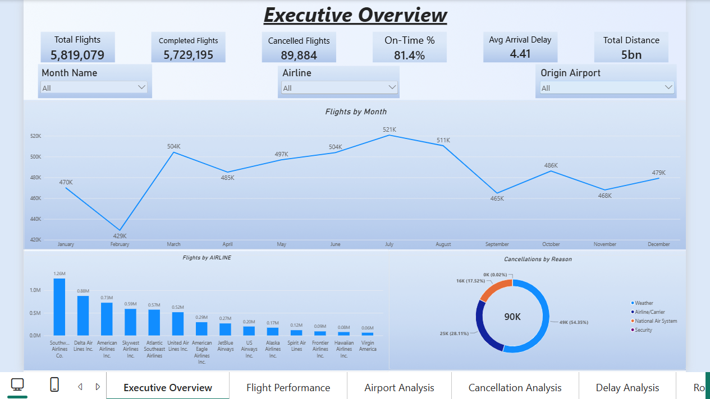
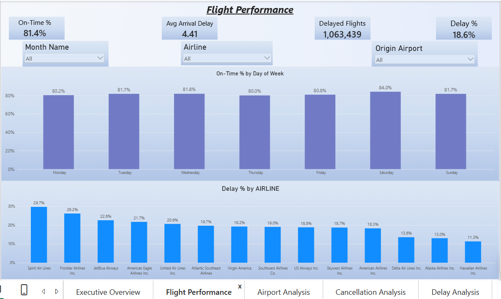
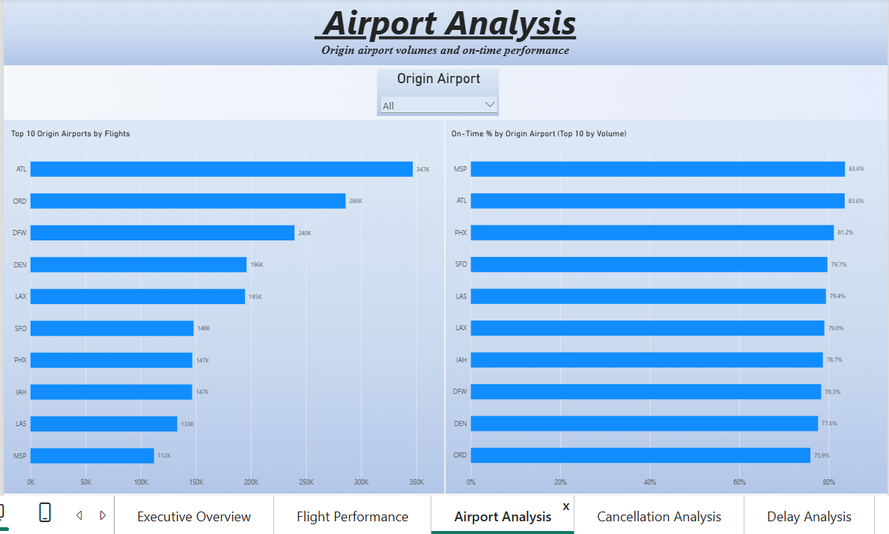
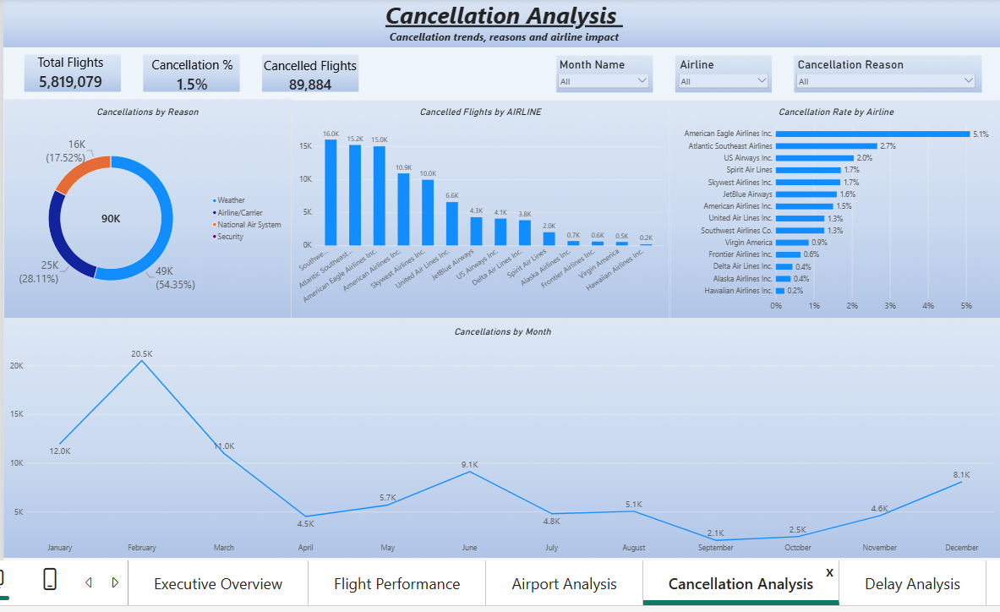
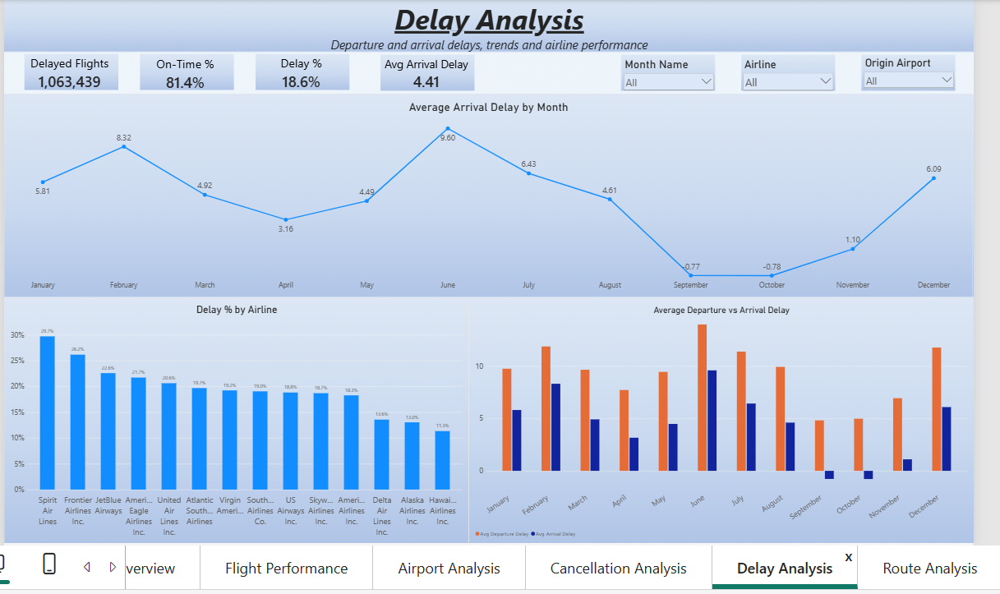
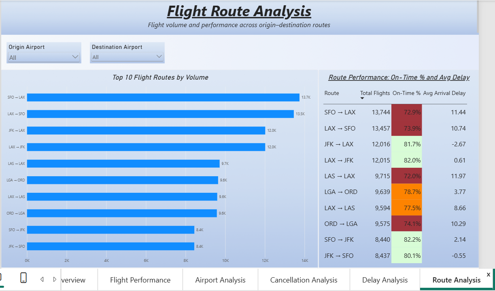

# ✈️ Airline Operations Dashboard

An interactive Power BI report analyzing **5.8 million U.S. domestic flights from 2015**: on-time performance, delays, cancellations, airports and routes. Data comes from the U.S. Department of Transportation (Bureau of Transportation Statistics).



## 📊 Project Overview

The report answers six practical questions an airline operations team would ask:

- How many flights ran, and how many were on time, delayed or cancelled?
- Which airlines are the most and least punctual?
- Which airports handle the most traffic, and how well do they perform?
- Why are flights cancelled, and when and where does it happen most?
- How do delays change across months, and how do departure delays compare with arrival delays?
- Which routes are the busiest, and which of them run late most often?

## 🗂️ Dataset

**Source:** [2015 Flight Delays and Cancellations (Kaggle, U.S. DOT)](https://www.kaggle.com/datasets/usdot/flight-delays)

| File | Description | Rows |
|---|---|---|
| `flights.csv` | Flight-level records: date, airline, airports, times, delays, cancellations, diversions | 5,819,079 (not in repo, see note) |
| `airlines.csv` | Airline code and name lookup | 14 |
| `airports.csv` | Airport code, name, city, state, latitude, longitude | 322 |
| `cancellation_codes.csv` | Cancellation reason lookup (A, B, C, D) | 4 |

> **Note:** `flights.csv` is about 500 MB, which is over GitHub's 100 MB file limit, so it is not included in this repo. Download it from the [Kaggle page](https://www.kaggle.com/datasets/usdot/flight-delays) to rebuild or refresh the report.

## 🧱 Data Model

Star schema with `Flights` as the fact table and four lookup (dimension) tables:

```
airlines ───────────┐
airports ───────────┼──► Flights ◄─── DateTable
cancellation_codes ─┘
```

- `airports` connects to `Flights` twice: **Origin** (active) and **Destination** (inactive, activated in DAX with `USERELATIONSHIP`)
- `DateTable` is a dedicated calendar table, marked as the report's date table

## 🔧 Power Query (ETL)

The raw `flights.csv` is reduced from 31 to 22 columns, typed correctly, and enriched with:

- `FlightDate`: a proper date built from YEAR, MONTH and DAY
- `IsOnTime`: 1 when the flight arrived less than 15 minutes late (US DOT standard)
- `Delay Category`: On Time, Minor, Major, Severe or Cancelled

Rows with numeric airport codes (which don't exist in the airports table) are filtered out.
Full code: [`powerquery/flights_query.pq`](powerquery/flights_query.pq)

## 🧮 Key DAX Measures

Full list: [`dax/measures.dax`](dax/measures.dax)

| Measure | Definition |
|---|---|
| Total Flights | All scheduled flights |
| Completed Flights | Not cancelled and not diverted |
| On-Time % | On-time flights ÷ completed flights |
| Delay % | Share of completed flights arriving 15+ minutes late |
| Cancellation % | Cancelled flights ÷ total flights |
| Avg Arrival / Departure Delay | Average delay in minutes, excluding cancellations |
| Total Distance | Sum of miles flown |

## 📑 Report Pages

### 1. Executive Overview
Headline KPIs, monthly flight volume, flights per airline, and cancellations by reason, with slicers for month, airline and origin airport.


### 2. Flight Performance
On-time % by day of the week and delay % by airline.



### 3. Airport Analysis
Top 10 origin airports by volume, and their on-time performance.



### 4. Cancellation Analysis
Cancellation reasons, cancelled flights and cancellation rate by airline, and the monthly trend.



### 5. Delay Analysis
Average arrival delay by month, delay % by airline, and departure vs arrival delay.



### 6. Route Analysis
Top 10 routes by volume, with on-time % (colour-coded) and average arrival delay per route.



## 📈 Key Insights

**Overall**
- Of **5,819,079** flights, **81.4%** of completed flights were on time, **18.6%** were delayed (1,063,439 flights), and **1.5%** (89,884) were cancelled.
- Flight volume peaked in **July (521K)** and was lowest in **February (429K)**, partly because February is a shorter month.

**Airlines**
- **Southwest** operated the most flights (1.26M), followed by Delta (0.88M) and American (0.73M).
- **Spirit (29.7%)** and **Frontier (26.2%)** had the highest delay rates. **Hawaiian (11.3%)**, **Alaska (13.0%)** and **Delta (13.6%)** had the lowest.
- **American Eagle** had the highest cancellation rate at **5.1%**, while Hawaiian had the lowest at 0.2%.

**Timing**
- **Saturday** was the most punctual day (84.0% on time) and **Thursday** the least (80.0%).
- Average arrival delay peaked in **June (9.6 min)** and fell below zero in **September and October**, meaning flights arrived slightly early on average.
- **February** had the most cancellations (20.5K), followed by January (12.0K) and March (11.0K).

**Cancellations**
- **Weather** caused 54.4% of cancellations, followed by airline/carrier issues (28.1%) and the national air system (17.5%). Security was negligible (0.02%).

**Airports and routes**
- **Atlanta (ATL)** was the busiest origin airport (347K flights), followed by Chicago O'Hare (286K) and Dallas/Fort Worth (240K).
- Among the top 10 airports, **MSP and ATL (83.6%)** had the best on-time rate, and **ORD (75.9%)** had the worst.
- **SFO → LAX** was the busiest route (13,744 flights) but had only a **72.9%** on-time rate. The reverse direction (LAX → SFO) was similar at 73.9%.

## 🛠️ Tools Used

- **Power BI Desktop**: data modeling, DAX and report design
- **Power Query (M)**: data cleaning and transformation
- **DAX**: KPI measures
- **Figma**: dashboard frontend design (layout, backgrounds and visual styling)

## 🚀 How to Use

1. Download `flights.csv` from the [Kaggle dataset](https://www.kaggle.com/datasets/usdot/flight-delays) and save it somewhere on your computer.
2. Open `AirlineOperations.pbix` in Power BI Desktop.
3. Go to **Home → Transform data**, select the `Flights` query, and edit the file path in the **Source** step.
4. Click **Close & Apply** to refresh.

## 📁 Repository Structure

```
├── AirlineOperations.pbix
├── README.md
├── .gitignore
├── data/
│   ├── airlines.csv
│   ├── airports.csv
│   └── cancellation_codes.csv
├── powerquery/
│   └── flights_query.pq
├── dax/
│   └── measures.dax
└── screenshots/
    ├── 01_executive_overview.png
    ├── 02_flight_performance.png
    ├── 03_airport_analysis.png
    ├── 04_cancellation_analysis.png
    ├── 05_delay_analysis.png
    └── 06_route_analysis.png
```

---

*Built with Power BI. Data from the U.S. Department of Transportation via Kaggle.*
